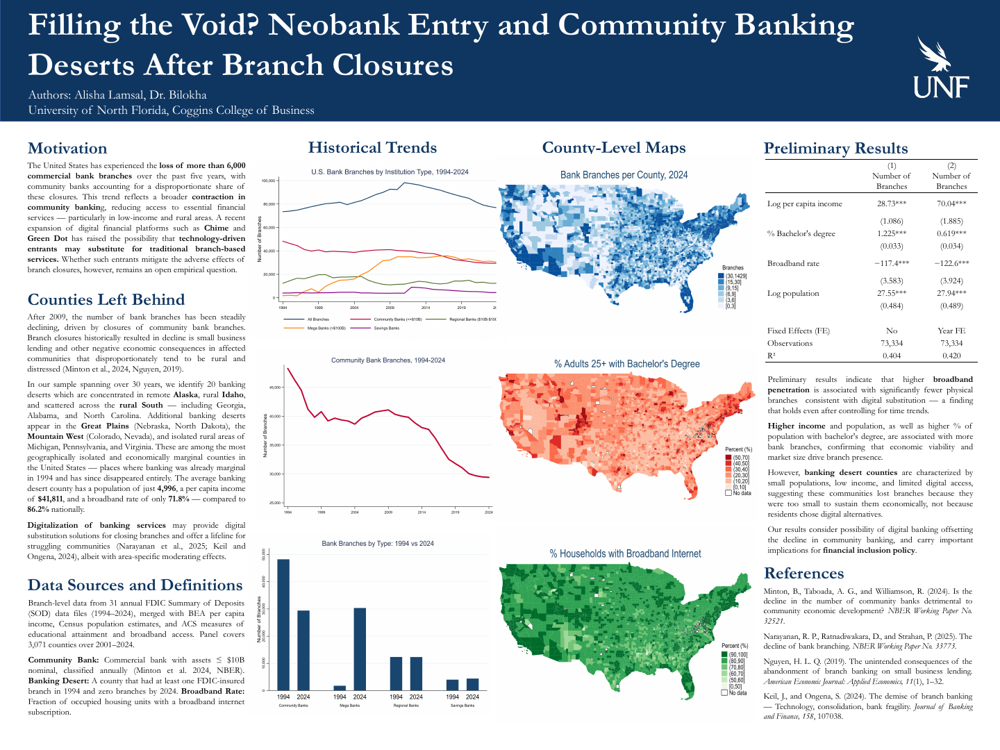
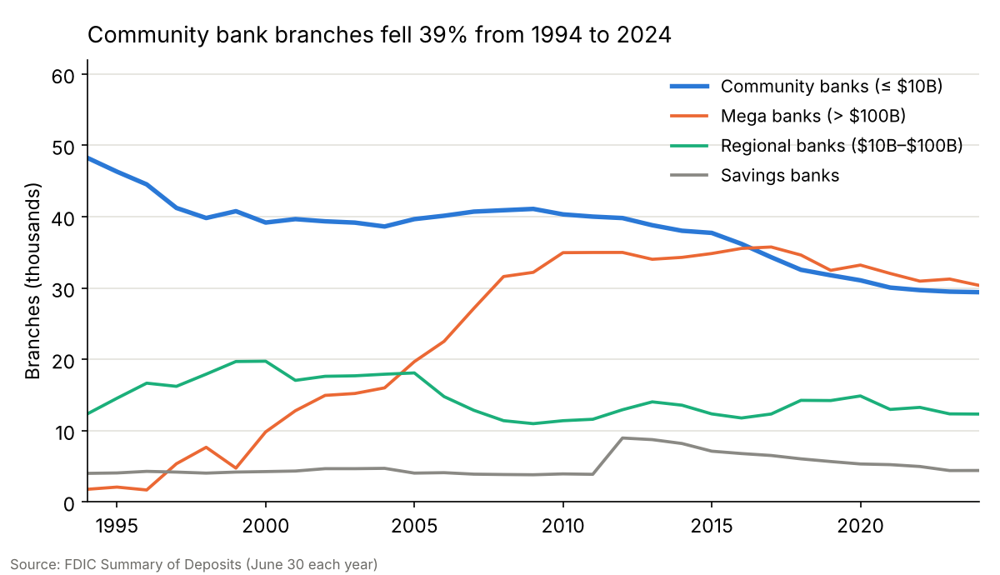
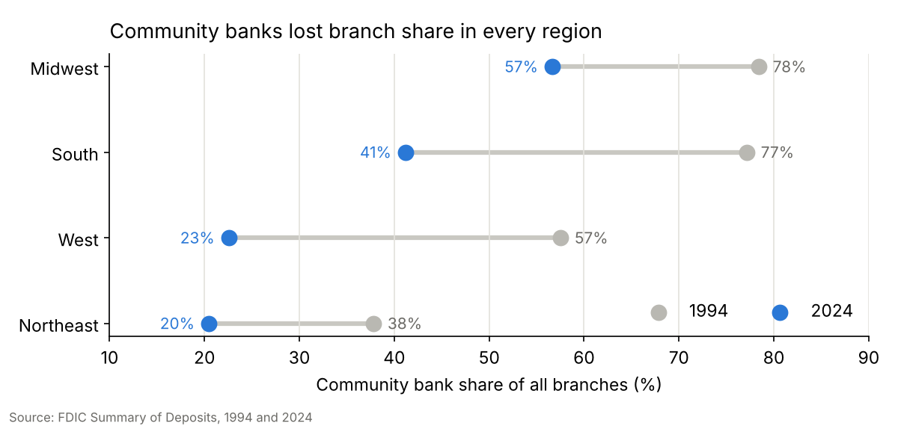
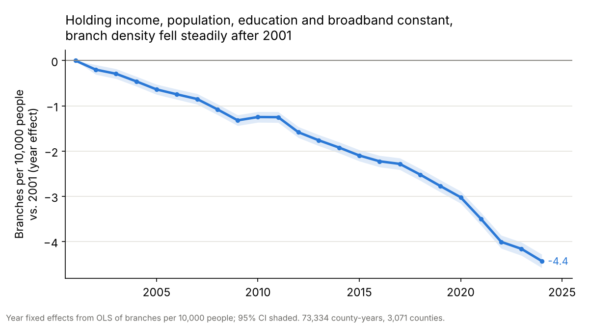
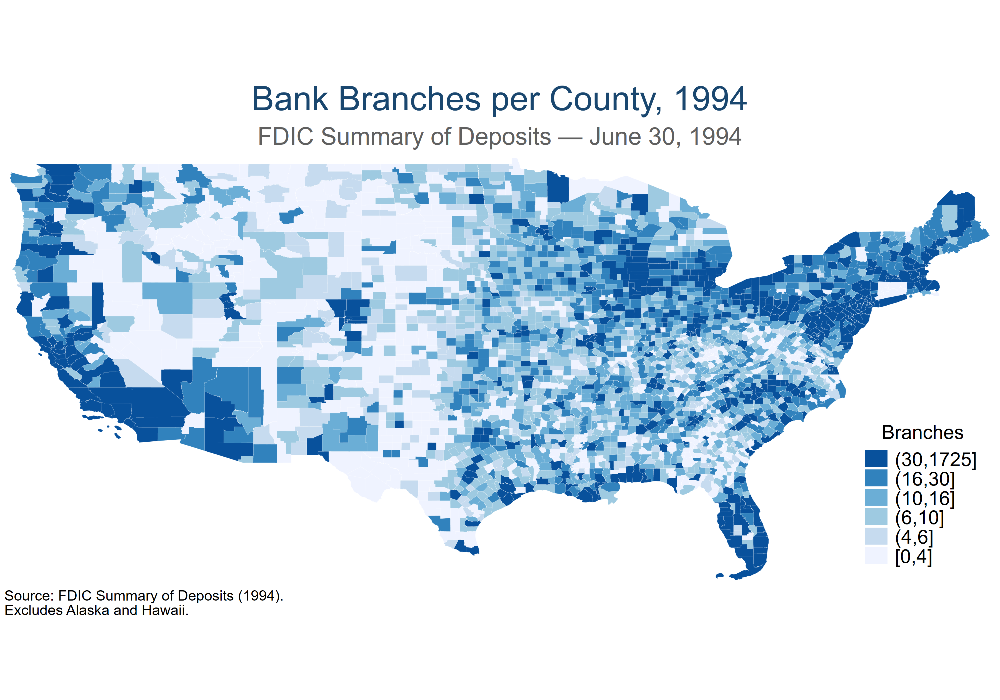
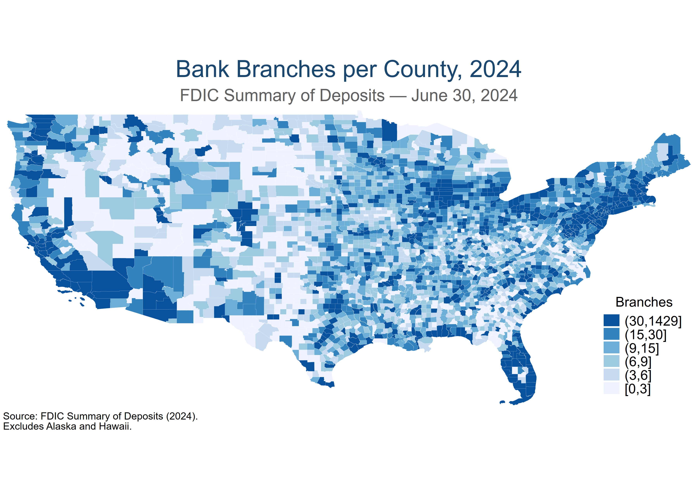

# Filling the Void? Neobank Entry and Community Banking Deserts After Branch Closures

As physical bank branches disappear, which communities lose access, and can digital banking fill the gap? This project builds a county-level panel from **30 years of FDIC branch data (1994–2024, 2.7M branch records)** across U.S. counties, adds Census and BEA data on income, population, education and broadband, and analyzes it in Stata.

**Alisha Lamsal** with **Dr. Bilokha**, Coggins College of Business, University of North Florida. Presented as a poster at the **UNF Spring 2026 Research Symposium** ([poster PDF](poster/Fintech_Poster.pdf)).

[](poster/Fintech_Poster.pdf)



---

## Key findings

**1. Branches shifted from community banks to the largest banks.** U.S. branches peaked at 99,550 in 2009 and fell to 76,727 by 2024. Community bank branches fell **39%**, from 48,264 to 29,410, while branches of banks with more than $100 billion in assets grew from 1,762 to 30,359. Community banks' share of all branches fell from 59% to 38%.

**2. Community banks lost branch share in every region.** (1994 shares are approximate; see Data quality checks.)



| Region | Community bank share, 1994* | Community bank share, 2024 | Change* |
|---|---|---|---|
| South | 77.1% | 41.2% | −35.9 pts |
| West | 57.5% | 22.6% | −34.9 pts |
| Midwest | 78.4% | 56.7% | −21.7 pts |
| Northeast | 37.8% | 20.5% | −17.3 pts |

\* Slightly overstated: 1994 regional totals miss branch records without a branch ID.

**3. Branch density kept falling even after accounting for local conditions.** Holding income, population, education and broadband constant, counties had **4.4 fewer branches per 10,000 people in 2024 than in 2001**. The average county has about 4.6, so that's close to all of a typical county's branch density.



**4. Counties that lost every branch are smaller, poorer and less connected.** 15 counties went from having at least one branch in 1994 to none in 2024. The 14 with Census data differ sharply from all other counties:

| | Banking desert counties | All other counties | Difference (p-value) |
|---|---|---|---|
| Adults 25+ with a bachelor's degree | 17.2% | 24.6% | p = 0.008 |
| Households with broadband | 71.2% | 86.2% | p < 0.001 |
| Per capita income | $40,581 | $60,046 | p < 0.001 |
| Average population | 4,578 | 109,207 | |

*Welch two-sample t-tests.* The poster reports 20 deserts. Five of them turned out to be county boundary changes (see Data quality checks), so this table uses the remaining 15. This is the core tension in the research question: the places losing physical branches are also the places least equipped to switch to digital-only banks.

**5. Losses were concentrated in older urban counties; growth went to fast-growing metros.** The largest branch losses were in Wayne County, MI (−131), Allegheny County, PA (−89) and Nassau County, NY (−86). The largest gains were in Cook County, IL (+348), Harris County, TX (+317) and Collin County, TX (+208, up 385%).

| 1994 | 2024 |
|---|---|
|  |  |

## Regression results

**Question:** which county characteristics go with more or fewer bank branches? **Sample:** 73,334 county-years, 3,071 counties, 2001–2024. Income and population are lagged one year. Robust standard errors are in parentheses. Columns (1) and (3) are the models shown on the poster.

**Outcome: number of bank branches in the county**

| | (1) No fixed effects | (2) County fixed effects | (3) Year fixed effects |
|---|---|---|---|
| Log per capita income, t−1 | 28.73*** (1.086) | 4.583*** (0.540) | 70.04*** (1.885) |
| % adults with bachelor's degree | 1.225*** (0.033) | −0.473*** (0.043) | 0.619*** (0.034) |
| Household broadband rate | −117.4*** (3.583) | −19.93*** (1.712) | −122.6*** (3.924) |
| Log population, t−1 | 27.55*** (0.484) | 17.05*** (1.706) | 27.94*** (0.489) |
| R² | 0.404 | 0.032 (within) | 0.420 |

\*\*\* p<0.01. Full tables, including year effects: [`data/results/`](data/results/).

**How to read it:**
- **Broadband:** counties with higher broadband access have significantly fewer physical branches, consistent with digital substitution. A 10-point higher broadband rate goes with about 12 fewer branches across counties (columns 1 and 3), and about 2 fewer within the same county over time (column 2).
- **Income and population:** richer and larger counties have more branches in every model.
- **Education:** positive across counties, but negative within a county over time, so it's best read as a cross-county pattern.

**Robustness check:** with branches *per 10,000 people* as the outcome, income stays positive, population turns negative (larger counties need fewer branches per person), and broadband stays negative with county fixed effects (−3.12***). With year fixed effects, though, it turns positive (+1.23***). So the broadband result depends on how branches are measured. The next step is a model with county and year fixed effects together.

## Data quality checks

- **County boundary changes.** A county can appear to lose every branch because its boundaries changed, not because banks left. Excluded from the banking desert count:
  - Connecticut's 8 counties, which the Census replaced with planning regions in 2022
  - 5 counties that were merged, split or renamed: Valdez-Cordova, Wrangell-Petersburg, Skagway-Hoonah-Angoon and Prince of Wales-Outer Ketchikan in Alaska, and Bedford City in Virginia. Their branches now appear under the new county names.
- **Changing Census variable codes.** The ACS bachelor's-degree percentage is stored in `S1501_C01_015E` for 2010–2014 but in `S1501_C02_015E` from 2015 on, where `C01` became a count. The code picks the right column for each year.
- **Missing branch IDs before 2011.** The poster run counted branches by their branch ID (`UNINUMBR`), which is blank for 6–10% of records from 1994 to 2010. That undercounted total branches in those years, so totals appeared to peak in 2011 instead of 2009. National totals and shares in this README use the full record counts. The do-file now counts every record. Regional 1994 shares, county-level 1994 counts and the regressions still come from the poster run and will be updated after a rerun.
- **Byte-order marks.** Some Census CSV downloads start with a hidden character that breaks Stata imports. `03_strip_bom_acs.py` removes it.

## Data

| Source | What it provides | Years |
|---|---|---|
| [FDIC Summary of Deposits (SOD)](https://www.fdic.gov/data-tools/summary-deposits-sod) | Every FDIC-insured branch: location, county, deposits, charter class (2,746,869 rows) | 1994–2024 |
| [FDIC BankFind Suite API](https://banks.data.fdic.gov/) | Year-end total assets for each bank (260,665 bank-years) | 1993–2024 |
| BEA CAINC1 | Per capita personal income, by county | 1994–2024 |
| Census population estimates | Annual county population | 2000–2024 |
| [Census ACS Table S1501](https://data.census.gov/) | Share of adults 25+ with a bachelor's degree, by county (5-year estimates) | 2010–2024 |
| [Census ACS Table B28002](https://data.census.gov/) | Share of households with broadband, by county (5-year estimates) | 2017–2024 |

**Bank size categories** (commercial banks, by total assets in that year's nominal dollars):
- **Community bank:** $10 billion or less, following Minton et al. (2024), NBER Working Paper 32521
- **Regional bank:** $10 billion to $100 billion
- **Mega bank:** more than $100 billion
- **Savings institutions** are tracked separately.

**Banking desert:** a county with at least one FDIC-insured branch in 1994 and none in 2024. **Broadband rate:** the share of occupied housing units with a broadband internet subscription.

## Limitations and next steps

- **No direct measure of neobank use.** Household broadband is used as a proxy for access to digital banking. County-level neobank adoption data would test the research question directly.
- **Early years reuse the earliest Census data.** Education before 2010 and broadband before 2017 are filled from the first available year, so changes within a county in those years come only from income and population.
- **Next model:** county and year fixed effects together, and community bank branches as a separate outcome.

## Pipeline

| Step | File | What it does |
|---|---|---|
| 1 | `scripts/01_download_fdic_assets.py` | Downloads year-end assets for every FDIC-insured bank from the BankFind API, with pagination and retries |
| 2 | `scripts/02_slim_sod_files.py` | Reduces 31 years of SOD files to the 15 columns needed and adds the survey year |
| 3 | `scripts/03_strip_bom_acs.py` | Removes hidden byte-order marks from Census CSV downloads |
| 4 | `scripts/04_poster_analysis.do` | Stacks the SOD files, classifies banks by size, builds county datasets, identifies banking deserts, merges BEA and Census data, runs the regressions, and produces the maps and Excel tables |

The do-file was reconstructed from the Stata log of the final run (`data/results/poster_analysis_log.txt`), with folder paths set once at the top.

## Repository structure

```
├── scripts/
│   ├── 01_download_fdic_assets.py
│   ├── 02_slim_sod_files.py
│   ├── 03_strip_bom_acs.py
│   └── 04_poster_analysis.do
├── data/
│   ├── processed/
│   │   ├── FDIC_Assets_New.dta       # year-end assets per bank, 1993–2024
│   │   ├── County_Panel.dta          # branches by bank type, county × year, 1994–2024
│   │   ├── County_Panel_Merged.dta   # + income, population, education, broadband, 2000–2024
│   │   ├── Population_Panel.dta
│   │   └── YearLevel_Summary.dta
│   └── results/
│       ├── Analysis_Tables.xlsx      # all summary tables
│       ├── regression_branches_per_capita.txt
│       ├── regression_num_branches.txt
│       ├── banking_deserts.csv
│       ├── region_summary.csv
│       ├── branches_by_bank_type.csv
│       └── poster_analysis_log.txt   # full Stata log of the final run
├── figures/
├── poster/
│   └── Fintech_Poster.pdf
└── README.md
```

> Raw FDIC and Census downloads are not included because of their size. The scripts download or prepare them from the public sources.

## References

- Keil, J., and Ongena, S. (2024). The demise of branch banking: Technology, consolidation, bank fragility. *Journal of Banking and Finance*, 158, 107038.
- Minton, B., Taboada, A. G., and Williamson, R. (2024). Is the decline in the number of community banks detrimental to community economic development? NBER Working Paper No. 32521.
- Narayanan, R. P., Ratnadiwakara, D., and Strahan, P. (2025). The decline of bank branching. NBER Working Paper No. 33773.
- Nguyen, H. L. Q. (2019). The unintended consequences of the abandonment of branch banking on small business lending. *American Economic Journal: Applied Economics*, 11(1), 1–32.

## Tools

Python (pandas, requests), Stata (outreg2, spmap), FDIC BankFind API, U.S. Census ACS, BEA
